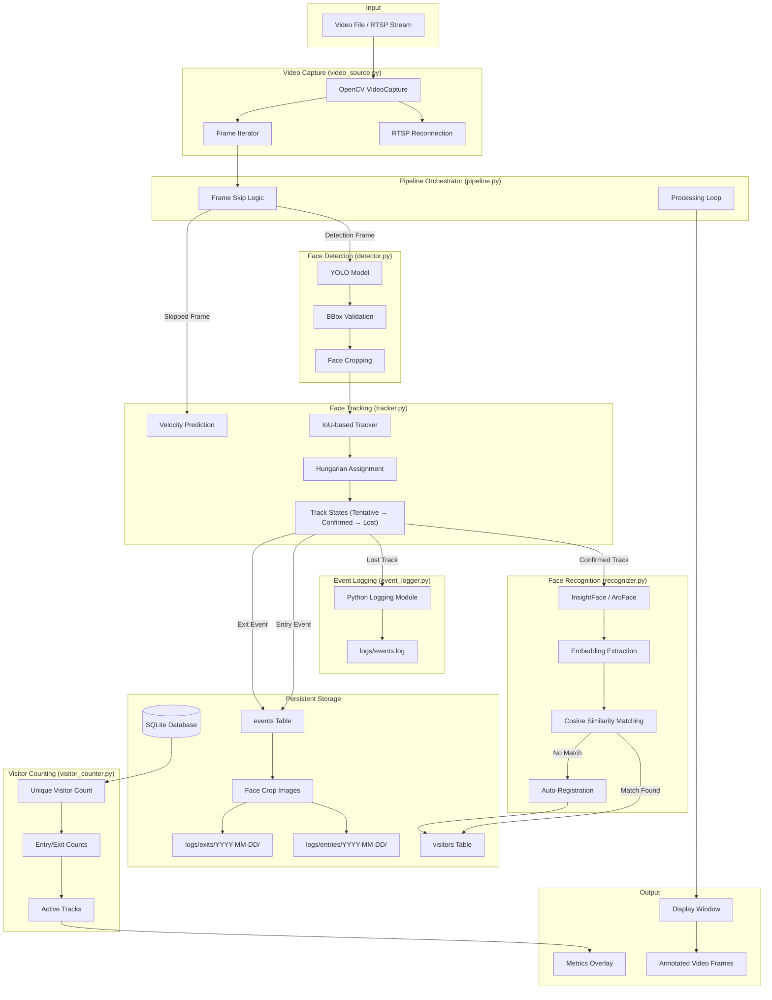

# System Architecture

## Overview

The Intelligent Face Tracker is a modular pipeline-based application that processes video streams through face detection, recognition, tracking, and event logging stages.

## Architecture Diagram



## Module Responsibilities

| Module | File | Responsibility |
|--------|------|----------------|
| Configuration | `app/config.py` | Load, validate, and provide config settings |
| Video Source | `app/video_source.py` | Video capture, RTSP reconnection, frame iteration |
| Detector | `app/detector.py` | YOLO face detection, bbox validation, face cropping |
| Recognizer | `app/recognizer.py` | Embedding extraction, cosine matching, registration |
| Tracker | `app/tracker.py` | IoU tracking, Hungarian assignment, track lifecycle |
| Database | `app/database.py` | SQLite CRUD, embedding serialization, event storage |
| Event Logger | `app/event_logger.py` | Structured logging, face image saving |
| Visitor Counter | `app/visitor_counter.py` | DB-backed metrics aggregation |
| Pipeline | `app/pipeline.py` | Orchestration of all components |
| Main | `main.py` | Entry point, CLI argument parsing |

## Data Flow

1. **Video Input** → OpenCV captures frames from file or RTSP stream
2. **Frame Skip** → Process every (N+1)th frame; predict on skipped frames
3. **Detection** → YOLO extracts face bounding boxes with confidence scores
4. **Tracking** → IoU matcher associates detections to existing tracks
5. **Recognition** → InsightFace generates embeddings for confirmed tracks
6. **Matching** → Cosine similarity against DB embeddings (threshold: 0.45)
7. **Registration** → Unmatched faces get new visitor IDs in SQLite
8. **Entry Event** → Generated when track transitions to CONFIRMED state
9. **Exit Event** → Generated when track is LOST for max_missing_frames
10. **Logging** → Events saved to DB + face crops saved to disk + events.log

## Database Schema

```sql
CREATE TABLE visitors (
    id TEXT PRIMARY KEY,          -- V-XXXXXXXX
    first_seen TEXT NOT NULL,
    last_seen TEXT NOT NULL,
    embedding BLOB NOT NULL,      -- 512 x float32
    visit_count INTEGER DEFAULT 1,
    created_at TEXT
);

CREATE TABLE events (
    id TEXT PRIMARY KEY,          -- E-XXXXXXXXXXXX
    visitor_id TEXT NOT NULL REFERENCES visitors(id),
    track_id INTEGER NOT NULL,
    event_type TEXT CHECK(event_type IN ('entry', 'exit')),
    timestamp TEXT NOT NULL,
    image_path TEXT,
    idempotency_key TEXT UNIQUE,  -- Prevent duplicates
    created_at TEXT
);
```
